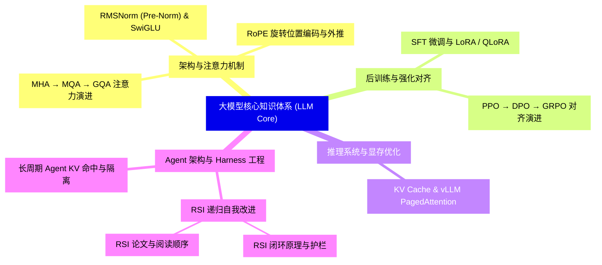

# 大模型知识库


把大模型的架构、后训练、推理系统、Agent 与 RSI 组织成「节点 + 母题卡」的笔记库。
每个节点是一篇能独立读的笔记；母题卡是配套的练习题，按「题眼 → 破题步骤 → 典型题 → 变式」展开。
内容持续更新，欢迎开 issue 指出错误或补充论文。

## 思维导图



## 索引

- [大模型核心知识体系 (LLM Core)](nodes/llm-root.md) — 架构注意力、后训练对齐、推理系统与 Agent Harness 全局骨架
  - [架构与注意力机制](nodes/cat-arch.md) — KV 压缩、相对位置外推与归一化激活稳定性
    - [MHA → MQA → GQA 注意力演进](nodes/node-gqa.md) — 共享 KV 头压缩显存带宽，平衡生成速度与表征能力 ｜ [PyTorch 手撕带 KV Broadcast 的 GQA](problems/prob-gqa-code.md) · [MHA/GQA/MLA 的 KV 显存压缩率与算术强度推导](problems/prob-kv-comp.md)
    - [RoPE 旋转位置编码与外推](nodes/node-rope.md) — 复平面绝对旋转等价于相对内积，支持 NTK/YaRN 扩窗 ｜ [RoPE 复数旋转推导与 NTK/YaRN 长窗外推](problems/prob-rope-math.md)
    - [RMSNorm (Pre-Norm) & SwiGLU](nodes/node-norm.md) — 去均值稳住残差梯度流，门控 FFN 以 8/3 d² 控参提效 ｜ [Pre-RMSNorm 梯度流与 SwiGLU 8/3 d² 参数计算](problems/prob-norm-swiglu.md)
  - [后训练与强化对齐](nodes/cat-post.md) — 从指令微调 SFT/LoRA 到 PPO、DPO、GRPO 的对齐范式演进
    - [SFT 微调与 LoRA / QLoRA](nodes/node-sft.md) — 低秩旁路降显存，警惕数据配比与 EOS 缺失引发复读 ｜ [SFT 复读机死循环、灾难性遗忘与 LoRA 调优排障](problems/prob-sft-lora.md)
    - [PPO → DPO → GRPO 对齐演进](nodes/node-grpo.md) — 砍掉 Critic 模型，以组内相对优势 A_i 驱动可验证推理对齐 ｜ [PPO vs DPO vs DeepSeek GRPO 损失函数与架构取舍](problems/prob-rl-grpo.md)
  - [推理系统与显存优化](nodes/cat-sys.md) — Prefill 计算受限与 Decode 访存受限下的 KV 管理与吞吐优化
    - [KV Cache & vLLM PagedAttention](nodes/node-vllm.md) — 页表映射非连续 KV Block 消除显存碎片，撑起高并发批处理 ｜ [大模型推理显存盘点与 KV Cache 容量/吞吐估算](problems/prob-kv-roofline.md) · [Prefix Caching (RadixAttention) 命中条件与缓存边界设计](problems/prob-prefix-caching.md)
  - [Agent 架构与 Harness 工程](nodes/cat-agent.md) — 模型之外的编排外壳：通用循环 + 记忆设计 + Harness + RSI 演进
    - [RSI 递归自我改进](nodes/node-rsi.md) — 让系统改进「产生产出的那套东西」，并让改进持续累积
      - [RSI 闭环原理与护栏](nodes/node-rsi-notes.md) — 改哪一层、谁来判、怎么防刷分：一个能落地的自改进闭环 ｜ [设计一个自改进 Coding Agent，并防止它刷分](problems/prob-rsi-guard.md) · [STaR 为什么相当于只在答对样本上做策略梯度](problems/prob-rsi-star.md)
      - [RSI 论文与阅读顺序](nodes/node-rsi-papers.md) — 从 Gödel Machine 到 DGM，按改写对象排好的阅读清单
    - [长周期 Agent KV 命中与隔离](nodes/node-harness.md) — 只追加历史保前缀缓存，Subagent 隔离探索噪声防腐烂 ｜ [长周期 Agent 的 KV Cache 命中率保护与 Subagent 隔离](problems/prob-harness-cache.md)

## 仓库结构

```text
llm-notes/
├── README.md      # 本页：导图 + 全库索引
├── nodes/         # 节点笔记（每篇独立可读）
└── problems/      # 母题卡（题眼 / 破题步骤 / 典型题 / 变式）
```

## 怎么读

1. 先看上面的思维导图，找到你关心的一支。
2. 从该支的根节点往下读，每篇开头都有「上级」链接可以回退。
3. 读完一篇，顺手过一遍对应的母题卡，检验是否真的会用了。

## 关于公式

笔记里的公式用 LaTeX 写，GitHub 原生渲染 `$...$` 与 `$$...$$`；如果在本地用 Obsidian / Typora 打开，语法同样通用。

## 许可

本仓库文字内容采用 [CC BY 4.0](https://creativecommons.org/licenses/by/4.0/) 许可，引用或转载注明出处即可。代码片段（如有）按各自上下文使用。
